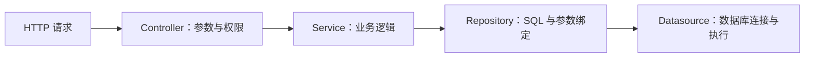

# Stemson

Stemson 是基于 **Rust + Axum** 的 API 服务骨架：用宏声明组件和路由，在启动时完成依赖注入，让业务代码集中在接口、业务逻辑和数据访问上。

项目由 [SanicBoot](https://github.com/lovemefan/SanicBoot) 的 Python/Sanic 版本重构而来，保留 Spring Boot 式的分层和约定。迁移差异见[迁移说明](docs/MIGRATION.md)。

## 它如何组织一个接口



你声明组件之间的依赖，例如 `user_repository: Arc<UserRepository>`；框架在启动时构造组件并注入字段。请求到来后，控制器调用已经构造好的服务。

| 能力 | 写法或行为 |
|------|------------|
| 组件注册与注入 | `#[service]`、`#[repository]`、`#[datasource("mysql")]`；字段按类型注入 |
| HTTP 路由 | `#[controller("/path")]` + `#[get]` / `#[post]`；也支持从模块路径推导 |
| 参数校验与权限 | `#[validate(...)]`、`#[protected]`、`#[authority([...])]` |
| 配置 | YAML 点号取值、`#[value("key")]` 注入、文件热重载 |
| 登录 | Argon2id 密码登录或 OPAQUE 协议登录，成功后均签发 JWT |
| 数据与响应 | MySQL / PostgreSQL / SQLite 参数化查询、事务和批量操作；Redis 基础命令；统一业务响应 `{ message, data, code }` |

## 先跑起来

以下命令均在仓库根目录执行。需要 Rust 1.91+；`rust-toolchain.toml` 使用 stable 工具链。

### 1. 启动服务，验证 HTTP 链路

```bash
./scripts/dev.sh
```

脚本默认加载 `config/config.dev.yaml`，监听 **8080**。数据库均为懒连接，因此可以先不启动外部数据库，验证健康检查、Swagger 和不访问数据库的接口。

```bash
curl http://127.0.0.1:8080/health
```

预期返回 HTTP 200，响应中的 `data.status` 为 `"ok"`。这只说明服务进程可处理请求，不检查数据库连通性。

- [Swagger UI](http://127.0.0.1:8080/swagger)：浏览和调用接口。
- [OpenAPI JSON](http://127.0.0.1:8080/openapi.json)：机器可读的接口定义。

### 2. 连接 MySQL，跑通登录

用户和认证接口默认使用 MySQL 8，也可以[切换到 PostgreSQL](#使用-postgresql) 或[使用 SQLite](#使用-sqlite)。首次建库时执行：

```bash
mysql -uroot -p < mysql/create_database.sql
```

然后在 `config/config.dev.yaml` 的 `datasource.mysql` 下设置主机、端口、用户名和密码，重启服务。脚本初始化的账号为：

| 账号 | 密码 | role | identity |
|------|------|------|----------|
| `admin` | `admin123` | 1（管理员） | 1（超级管理员） |
| `lovemefan` | `lovemefan123` | 1（管理员） | 2（管理员） |

开发配置的 `server.auth.mode` 为 `both`，可以先用种子账号进行密码登录：

```bash
curl -X POST http://127.0.0.1:8080/v1/api/auth \
  -H 'Content-Type: application/json' \
  -d '{"username":"admin","password":"admin123"}'
```

成功响应：

```json
{"message":"success","data":{"access_token":"...","token_type":"Bearer","expires_in":1800},"code":"0000"}
```

把 `access_token` 填入下一条请求：

```bash
curl http://127.0.0.1:8080/v1/api/auth/me \
  -H 'Authorization: Bearer <access_token>'
```

新用户的邀请注册和 OPAQUE 登录流程见 [API 文档](docs/API.md#3-认证先选登录方式再获取-jwt)。

### 也可以用 Docker 启动整套服务

```bash
docker compose up --build
```

Compose 会启动服务、MySQL 和 Redis，对外端口为 **8080**。MySQL 仅在数据卷首次初始化时运行建库脚本；已有数据卷的表结构升级需要单独处理。

### 使用 PostgreSQL

可以直接启动 PostgreSQL 16、Redis 和应用：

```bash
docker compose -f docker-compose.postgres.yml up --build
```

应用监听 **8080**，种子账号和登录方式与 MySQL 相同。PostgreSQL 数据和 OPAQUE 长期密钥均保存在命名卷中。初始化脚本仅在数据库数据卷首次创建时执行。

本地运行时，先准备可登录的 `stemson` 数据库用户，然后创建空数据库并导入表结构：

```bash
createdb -h 127.0.0.1 -U stemson stemson_backend_system
psql -h 127.0.0.1 -U stemson -d stemson_backend_system \
  -v ON_ERROR_STOP=1 -f postgres/create_database.sql
STEMSON_CONFIG=config/config.postgres.yaml cargo run
```

在 `config/config.postgres.yaml` 的 `datasource.postgres` 下填写连接信息；示例用户名和密码均为 `stemson`。现有配置也可以设置 `datasource.driver: postgres`（兼容 `postgresql`、`pgsql`），并添加同名连接配置。未设置 `driver` 时继续使用 MySQL。切换数据库后需要重启；此操作不会自动迁移已有 MySQL 数据。

自定义 Repository 可以注入 `Arc<PostgresDataSource>`，调用 `fetch_all`、`fetch_optional`、`fetch_one`、`execute`、`execute_many` 和 `begin`。PostgreSQL SQL 使用 `$1`、`$2` 占位；批量执行传入 `Vec<sqlx::postgres::PgArguments>`，支持 `None::<i64>` 等带类型的空值。详见[数据访问与事务](docs/ARCHITECTURE.md#6-数据访问与事务)。

### 使用 SQLite

SQLite 将数据库保存在本地文件中，无需启动数据库服务。在仓库根目录初始化一个空数据库后启动：

```bash
sqlite3 -bail stemson.db < sqlite/create_database.sql
STEMSON_CONFIG=config/config.sqlite.yaml cargo run
```

应用监听 **8080**，种子账号和登录方式与 MySQL 相同。初始化脚本用于空数据库，已有文件无需重复导入。`datasource.driver: sqlite` 选择 SQLite；`datasource.sqlite.path` 指定文件路径，相对路径以进程工作目录为基准，父目录需已存在。连接池可以创建缺失的文件，但不会自动建表或迁移其他数据库的数据。

文件数据库启用 WAL，默认最多 5 个连接，写锁等待超时为 5 秒。`path: ":memory:"` 使用单个连接保存内存数据库，进程退出后数据消失；普通本地运行请使用文件路径。自定义 Repository 可注入 `Arc<SqliteDataSource>`，使用 `?` / `?1` 参数绑定；批量执行接收 `Vec<sqlx::sqlite::SqliteArguments<'_>>`。

## 新增一个接口

先做一个无需数据库的例子：`GET /hello/Ada` 返回问候语。只需声明一个 Service、一个 Controller，并让 Rust 编译这两个模块。

**第一步：新增 `src/service/greeting_service.rs`。**

```rust
#[stemson::service]
pub struct GreetingService {}

impl GreetingService {
    pub fn greet(&self, name: &str) -> String {
        format!("Hello, {name}!")
    }
}
```

**第二步：新增 `src/controller/greeting_controller.rs`。**

```rust
use std::sync::Arc;

use crate::service::greeting_service::GreetingService;
use stemson::{ApiResponse, ApiResult, RequestContext};

#[derive(stemson::Autowired)]
pub struct GreetingController {
    greeting_service: Arc<GreetingService>,
}

#[stemson::controller("/hello")]
impl GreetingController {
    #[get("/{name}")]
    async fn hello(&self, ctx: RequestContext) -> ApiResult<ApiResponse> {
        let name = ctx.path_param("name").unwrap_or("world");
        let message = self.greeting_service.greet(name);
        Ok(ApiResponse::success(serde_json::json!({ "greeting": message })))
    }
}
```

**第三步：在各自的 `mod.rs` 中声明模块。**

```rust
// src/service/mod.rs 增加
pub mod greeting_service;

// src/controller/mod.rs 增加
pub mod greeting_controller;
```

重启服务后验证：

```bash
curl http://127.0.0.1:8080/hello/Ada
# {"message":"success","data":{"greeting":"Hello, Ada!"},"code":"0000"}
```

`pub mod` 让代码参与编译，宏负责注册和注入，无需维护中心组件列表。新增路由的 OpenAPI 描述还需要在 `src/openapi.rs` 中维护；控制器宏不会自动生成接口文档。

接入数据库时，再增加 Repository，并让 Service 注入它。SQL 放在 Repository 中，使用占位符（MySQL / SQLite 为 `?`，PostgreSQL 为 `$1`、`$2`）和 `.bind(...)` 绑定输入；完整分层和宏规则见[架构文档](docs/ARCHITECTURE.md)。

## 配置怎么选

`STEMSON_CONFIG` 指定的是一份完整配置文件，开发配置不会自动叠加到默认配置上。

| 启动方式 | 配置文件 | 端口 |
|----------|----------|------|
| `./scripts/dev.sh` | `config/config.dev.yaml` | 8080 |
| `cargo run` | `config/config.yaml` | 80 |
| `docker compose up --build` | `config/config.docker.yaml` | 8080 |
| `STEMSON_CONFIG=config/config.postgres.yaml cargo run` | `config/config.postgres.yaml` | 8080 |
| `docker compose -f docker-compose.postgres.yml up --build` | `config/config.postgres.docker.yaml` | 8080 |
| `STEMSON_CONFIG=config/config.sqlite.yaml cargo run` | `config/config.sqlite.yaml` | 8080 |

```bash
STEMSON_CONFIG=config/config.dev.yaml cargo run
```

- JWT 密钥支持 `STEMSON_JWT_SECRET` 环境变量覆盖。
- 认证模式：`password` 只允许密码登录，`both` 支持两条登录路径，`opaque` 关闭密码登录端点。
- OPAQUE 首次初始化会生成 `config/opaque_server_setup.bin`。这份长期密钥需要持久保存和备份；丢失后，原注册记录无法继续使用。默认 MySQL Compose 未为它配置持久卷；PostgreSQL Compose 已配置。
- Redis 在默认单实例配置下可选；OPAQUE 多副本防重放需要共享 Redis，并设置 `server.auth.opaque.nonce_store: redis`。
- 热重载只影响后续读取配置的逻辑。端口、连接池、JWT 和认证模式等已初始化的对象需要重启，详见[配置生效范围](docs/ARCHITECTURE.md#7-配置什么时候生效)。

### 使用 Nacos 配置中心

启动时可从 Nacos 拉取一份 YAML，按字段递归覆盖 `STEMSON_CONFIG` 指定的本地配置（默认 `config/config.yaml`）。Nacos 只需填写要覆盖的字段，未提供的字段继续使用本地值。例如在 Nacos 创建 Data ID 为 `config.yaml`、Group 为 `DEFAULT_GROUP` 的 YAML 配置：

```yaml
server:
  http:
    port: 9090
datasource:
  mysql:
    host: mysql.internal
```

```bash
NACOS_ENABLED=true \
NACOS_SERVER_ADDR=http://127.0.0.1:8848 \
NACOS_DATA_ID=config.yaml \
NACOS_GROUP=DEFAULT_GROUP \
STEMSON_CONFIG=config/config.dev.yaml cargo run
```

| 环境变量 | 默认值 | 说明 |
|----------|--------|------|
| `NACOS_ENABLED` | `false` | 是否启用配置中心拉取；支持 `true/false`、`1/0`、`yes/no`、`on/off`，不区分大小写 |
| `NACOS_SERVER_ADDR` | `http://127.0.0.1:8848` | 单个 HTTP(S) 地址；可省略 `http://`，默认上下文路径 `/nacos`，也可显式指定自定义路径 |
| `NACOS_DATA_ID` | `config.yaml` | 远端配置的 Data ID，内容须为 YAML 对象 |
| `NACOS_GROUP` | `DEFAULT_GROUP` | 配置分组 |
| `NACOS_NAMESPACE` | 空 | 命名空间 **ID**，空值使用 public；不填命名空间显示名称 |
| `NACOS_USERNAME` | 未设置 | 开启 Nacos 认证时使用，须与密码同时设置 |
| `NACOS_PASSWORD` | 未设置 | Nacos 登录密码 |
| `NACOS_TIMEOUT_MS` | `5000` | 单次 HTTP 请求超时，正整数毫秒；登录和拉取分别计时 |

启用后通过 Nacos HTTP OpenAPI `/v1/cs/configs` 拉取；配置账号密码时先调用 `/v1/auth/login` 获取令牌。Nacos 返回 404 或空内容时保留本地配置；连接失败、超时、认证失败或远端 YAML 非法时启动报错。未启用时不访问 Nacos，也不校验其余 `NACOS_*` 参数。本地配置文件始终需要存在且有效。

对象递归合并，数组、标量和显式 `null` 整体替换对应本地节点。Nacos 配置在日志、组件和数据源初始化前生效；本地文件热重载时会重新应用启动时取得的 Nacos 覆盖值。当前不订阅或轮询远端变更，修改 Nacos 配置或连接环境变量后需重启。`STEMSON_JWT_SECRET` 仍优先于配置树中的 JWT 密钥。

框架调用方可使用 `Config::load_with_nacos(path).await` 或 `Config::load_default_with_nacos().await`；现有同步 `Config::load` / `Config::load_default` 继续只读取本地文件。

应用在日志系统初始化后记录实际配置来源：本地文件路径、Nacos 服务地址、Data ID、Group、命名空间，以及是否应用远端覆盖；远端无配置时输出 WARN，未启用时记录仅使用本地 YAML。日志同时写入控制台和配置的日志文件，遵循日志级别过滤，不输出账号密码、令牌或配置正文。框架调用方可在初始化日志后调用 `config.log_source()`；本地热重载日志中的 `nacos_overlay_applied` 表示是否重新应用了远端覆盖。

### 使用 Nacos 注册中心

设置 `NACOS_REGISTRY_ENABLED=true` 后，应用在绑定 HTTP 端口后向 Nacos 注册临时实例，默认每 5 秒发送心跳。第三方通过 Nacos 的服务发现接口或 SDK 查询健康实例，再直接调用实例的 HTTP 地址。注册中心与配置中心分别控制，可单独启用，也可同时启用。

```bash
# 替换为第三方能访问到的本机或容器 IP
NACOS_REGISTRY_ENABLED=true \
NACOS_SERVER_ADDR=http://127.0.0.1:8848 \
NACOS_SERVICE_NAME=stemson_backend \
NACOS_INSTANCE_IP=192.168.1.20 \
STEMSON_CONFIG=config/config.dev.yaml cargo run
```

注册中心复用 `NACOS_SERVER_ADDR`、`NACOS_NAMESPACE`、`NACOS_USERNAME`、`NACOS_PASSWORD` 和 `NACOS_TIMEOUT_MS`。命名空间仍填写 ID，空值代表 public。配置中心的 `NACOS_DATA_ID` 和 `NACOS_GROUP` 不影响服务注册。

| 环境变量 | 默认值 | 说明 |
|----------|--------|------|
| `NACOS_REGISTRY_ENABLED` | `false` | 服务注册独立开关，布尔值规则同上 |
| `NACOS_SERVICE_NAME` | 合并后配置的 `server.name`，缺省为 `stemson_backend` | 第三方发现使用的服务名 |
| `NACOS_SERVICE_GROUP` | `DEFAULT_GROUP` | 服务分组，独立于配置中心分组 |
| `NACOS_CLUSTER_NAME` | `DEFAULT` | 实例集群名 |
| `NACOS_INSTANCE_IP` | HTTP 监听 IP | 第三方可访问的实例 IP；监听 `0.0.0.0` 或 `::` 时必须显式指定；不接受通配、多播地址或域名 |
| `NACOS_INSTANCE_PORT` | HTTP 实际绑定端口 | 对外端口；容器端口映射场景可指定宿主机端口，范围 1–65535 |
| `NACOS_METADATA` | `{}` | JSON 对象，值须为字符串，例如 `'{"version":"2.0","protocol":"http"}'` |
| `NACOS_HEARTBEAT_INTERVAL_MS` | `5000` | 心跳间隔，1000–5000 毫秒；服务端返回建议间隔时在此范围内调整 |

服务名、分组和集群名不能为空或包含 `@@`。配置注册参数变更需要重启。监听具体 IP 时可直接使用该 IP；跨主机部署应设置可路由地址，`127.0.0.1` 只适合同机调用。端口映射场景需同时设置可达的宿主机 IP 和映射端口。

例如，第三方查询 `stemson_backend` 的健康实例（需要 `curl` 和 `jq`）：

```bash
# Nacos 开启认证时先登录，并为下面的查询增加 --data-urlencode "accessToken=$NACOS_TOKEN"
# 非 public 命名空间需增加 --data-urlencode "namespaceId=实际命名空间ID"
instances=$(curl --fail --silent --show-error --get \
  'http://127.0.0.1:8848/nacos/v1/ns/instance/list' \
  --data-urlencode 'serviceName=stemson_backend' \
  --data-urlencode 'groupName=DEFAULT_GROUP' \
  --data-urlencode 'healthyOnly=true')
endpoint=$(printf '%s' "$instances" | jq -er \
  '.hosts | map(select(.healthy and .enabled)) | first | select(. != null) | if (.ip | contains(":")) then "[\(.ip)]:\(.port)" else "\(.ip):\(.port)" end')
curl --fail "http://$endpoint/health"
```

生产调用方应使用 Nacos SDK 的实例订阅、负载均衡和故障重试。业务接口继续遵循现有 JWT 认证规则，注册实例不会改变接口权限。

实现使用 Nacos HTTP v1 OpenAPI（`/v1/ns/instance`、`/v1/ns/instance/beat`），需要服务端开放这些兼容接口。注册失败时启动报错；运行期间心跳失败输出 WARN 并重试，实例丢失时重新注册。账号认证令牌会按有效期提前刷新，遇到 401/403 会重新登录并重试一次。Ctrl-C / SIGTERM 时先停止心跳并注销，再停止接收新请求；异常退出或注销失败由 Nacos 根据临时实例超时剔除。INFO 记录注册地址、服务名、分组、命名空间、实例 IP/端口及注销，DEBUG 记录正常心跳，不输出密码、令牌或元数据正文。

框架调用方可在绑定监听器后调用 `stemson::nacos::Registration::start_from_env(&config, listener.local_addr()?).await?`，保留返回的 guard，并在关闭 HTTP 前调用 `guard.shutdown().await`。

## 代码在哪里

```text
src/
  main.rs / app.rs        启动、路由装配和全局中间件
  core/                   组件容器、依赖注入和路由推导
  controller/             HTTP 接口
  service/                业务逻辑
  repository/             SQL 与数据映射
  datasource/             MySQL / PostgreSQL / SQLite / Redis
  request/                请求解析与参数读取
  auth.rs / auth/         JWT / OPAQUE
  model/ / exception.rs   响应、业务码、身份模型和错误
  config.rs / openapi.rs  配置与接口文档
  nacos/                  Nacos 认证、实例注册、心跳和注销
  utils/                  日志、密码哈希和雪花 ID
stemson-macros/            过程宏
config/                   默认、开发和 Docker 配置
mysql/                    建库脚本
postgres/                 PostgreSQL 建表与种子账号脚本
sqlite/                   SQLite 建表与种子账号脚本
scripts/ / examples/      开发、端到端测试和压测工具
tests/                    集成测试
docs/                     使用与设计文档
```

## 常用命令

```bash
cargo fmt --all
cargo clippy --all-targets -- -D warnings
cargo test

# 需要服务已启动，且所选 MySQL / PostgreSQL / SQLite 已初始化
STEMSON_URL=http://127.0.0.1:8080 ./scripts/e2e-test.sh

# PostgreSQL 专项集成测试（需要已初始化的临时测试库）
STEMSON_TEST_POSTGRES_CONFIG=config/config.postgres.yaml cargo test --test postgres -- --ignored

# SQLite 专项集成测试（自动创建和清理临时数据库，无需外部服务）
cargo test --test sqlite

# 生成 Argon2id 密码哈希
cargo run --example hash_password -- 'your-password'

# 对运行中的服务压测
scripts/benchmark.sh http://127.0.0.1:8080
```

## 按任务查文档

| 你想做什么 | 阅读 |
|------------|------|
| 理解启动、注入、路由和请求处理 | [架构设计](docs/ARCHITECTURE.md) |
| 调用认证与用户接口、排查业务码 | [API 文档](docs/API.md) |
| 迁移 Python 数据、客户端和配置 | [迁移说明](docs/MIGRATION.md) |
| 查看性能数据、测量口径和复现方法 | [性能对比](docs/BENCHMARK.md) |
| 了解重构保留了什么、为什么这样取舍 | [重构决策](docs/REFACTOR_PLAN.md) |

## License

MIT
