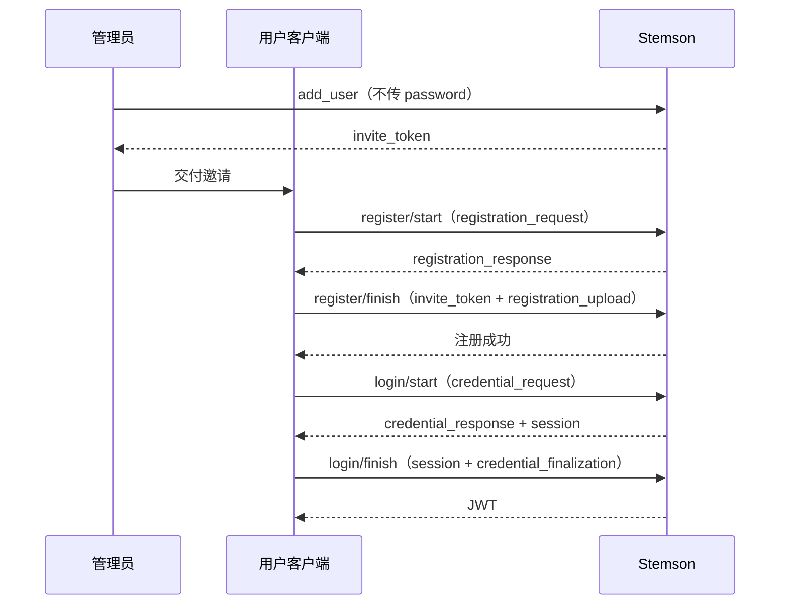

# API 文档

本文描述当前 Rust 服务的实际接口。示例使用开发地址 `http://127.0.0.1:8080`；启动步骤见 [README](../README.md)。用户和登录接口需要已初始化的 MySQL。

建议先用密码登录获取 JWT，再调用受保护接口；需要 OPAQUE 时，按“管理员发邀请 → 客户端注册 → 客户端登录”的顺序接入。

| 用途 | 方法与路径 | 条件 |
|------|------------|------|
| 密码登录 | `POST /v1/api/auth` | `password` 或 `both` 模式 |
| OPAQUE 注册 | `POST /v1/api/auth/register/start`、`/register/finish` | OPAQUE 已启用；完成注册需要邀请 |
| OPAQUE 登录 | `POST /v1/api/auth/login/start`、`/login/finish` | OPAQUE 已启用，账号已注册 |
| 当前用户 / token 校验 | `GET /v1/api/auth/me`、`/verify` | 有效 JWT |
| 续签 token | `POST /v1/api/auth/refresh` | 尚未过期的 JWT |
| 用户管理 | `POST /user/user_controller/...`、`POST /getall` | JWT + 对应权限，见第 4 节 |
| 存活检查 | `GET /health` | 无需数据库和 JWT |
| 交互文档 / 接口定义 | `GET /swagger`、`GET /openapi.json` | 无需 JWT |

## 1. 统一响应体

业务接口、健康检查及框架错误响应使用以下结构，字段顺序固定。Swagger 页面和 OpenAPI JSON 使用各自格式：

```json
{
  "message": "success",
  "data": null,
  "code": "0000"
}
```

| 字段 | 说明 |
|------|------|
| `message` | 人类可读信息；错误时为错误原因 |
| `data` | 业务数据，没有时为 `null` |
| `code` | 4 位业务码，见下表（与 HTTP 状态码相互独立） |

请求要求：

- 需要 JSON 参数的业务接口必须使用 `Content-Type: application/json`，请求体必须为对象；空 body 或未按 JSON 解析时，字段校验 / `json_as()` 返回 `0010`。无请求体的 `/verify`、`/getall` 等接口不要求此头。
- 请求体上限由 `server.http.request_max_size` 控制，默认 10 MiB，超出返回 HTTP 413 / `0015`。
- 默认请求超时 30 秒（`server.http.request_timeout`，`0` 关闭），超时返回 `0001` / 408。

## 2. 业务码

| code | 枚举名 | HTTP | 含义 |
|------|--------|------|------|
| `0000` | SUCCESS | 200 | 成功 |
| `0001` | REQUEST_TIMEOUT | 408 | 请求超时 |
| `0002` | NOT_FOUND | 404 | 资源/路由不存在（405 也会带此码） |
| `0003` | TOKEN_AVAILABLE | 200 | token 可用 |
| `0004` | TOKEN_NOT_AVAILABLE | 401 | token 非法/不可用 |
| `0005` | USERNAME_OR_PASSWORD_EMPTY | 400 | 用户名或密码为空 |
| `0006` | USERNAME_OR_PASSWORD_ERROR | 401 | 用户名或密码错误 |
| `0007` | TOKEN_TIMEOUT | 401 | token 过期 |
| `0008` | PERMISSION_DENIED | 403 | 身份不足 |
| `0009` | ADD_USER_FAILED | 400 | 添加用户失败（如 role 非 0/1） |
| `0010` | MISS_PARAMETERS | 400 | 缺少参数 |
| `0011` | DELETE_USER_FAILED | 400 | 删除用户失败 |
| `0012` | MODIFY_USER_FAILED | 400 | 修改用户失败 |
| `0013` | USER_NOT_EXIST | 404 | 用户不存在 |
| `0014` | UNAUTHORIZED | 401 | 未认证（缺少 Authorization） |
| `0015` | INVALID_PARAMETER | 400 | 参数非法 |
| `0016` | INTERNAL_SERVER_ERROR | 500 | 服务内部错误（详情只写日志） |
| `0017` | USER_ALREADY_EXIST | 409 | 用户名已存在（Rust 版新增） |

## 3. 认证：先选登录方式，再获取 JWT

### 3.1 选择登录方式

| `server.auth.mode` | 密码登录端点 | OPAQUE 注册 / 登录 |
|--------------------|--------------|--------------------|
| `password` | 可用 | 不可用 |
| `both`（仓库配置） | 可用 | 可用 |
| `opaque` | 返回 `0015` | 可用 |

两种登录最终都返回相同的 JWT。后续请求统一携带 `Authorization: Bearer <access_token>`。这里的 `opaque` 模式关闭的是签发 JWT 的密码登录端点；旧的 `validate_password` 校验接口仍存在，见 4.1。

种子账号只有 Argon2id 密码哈希，不能直接使用 OPAQUE。先在 `both` 模式下用它创建邀请账号，完成注册并确认管理员可用后再切换模式。现有账号的邀请补发和 OPAQUE 密码重置没有独立接口。

### 3.2 密码登录

```http
POST /v1/api/auth
Content-Type: application/json

{"username": "admin", "password": "admin123"}
```

```json
{
  "message": "success",
  "data": {
    "access_token": "eyJ0eXAiOiJKV1Qi...",
    "token_type": "Bearer",
    "expires_in": 1800
  },
  "code": "0000"
}
```

密码为明文输入，部署时应通过 HTTPS 传输，服务端用 Argon2id 校验。长度要求 1–256；错误包括 `0010`（缺参数）、`0015`（长度非法或该登录路径关闭）、`0013`（用户不存在）、`0006`（密码错误或账号仅有 OPAQUE 记录）、`0008`（账号被禁用）。

### 3.3 当前用户

```http
GET /v1/api/auth/me
Authorization: Bearer <token>
```

```json
{
  "message": "success",
  "data": {
    "me": {
      "user_id": 1341983140255768576,
      "username": "admin",
      "phone": null,
      "email": null,
      "role": 1,
      "create_by": "admin",
      "create_time": "2020-12-24 13:37:38",
      "last_login_time": "2026-11-10 14:40:03",
      "status": 1
    }
  },
  "code": "0000"
}
```

### 3.4 校验 token

```http
GET /v1/api/auth/verify
Authorization: Bearer <token>
```

```json
{"message":"success","data":{"valid":true,"user_id":1341983140255768576,"username":"admin","expires_at":1794294556},"code":"0000"}
```

### 3.5 续签

```http
POST /v1/api/auth/refresh
Authorization: Bearer <token>
```

返回与登录相同的 `TokenResponse`（`access_token` 为新的 token）。这不是 refresh token 机制：原 token 必须尚未过期，过期后需要重新登录。

### 3.6 OPAQUE：先邀请注册，再登录

OPAQUE 是客户端与服务端共同执行的密码协议。密码在客户端用于生成协议消息，发送给服务端的是消息而非密码。注册完成后，账号保存 `opaque_registration`，`password` 置空；该账号不能通过密码登录端点登录。



#### 管理员创建邀请

```bash
curl -X POST http://127.0.0.1:8080/user/user_controller/add_user \
  -H 'Content-Type: application/json' \
  -H "Authorization: Bearer $ADMIN_TOKEN" \
  -d '{"username":"alice","role":0,"email":"alice@example.com"}'
```

成功响应的 `data` 包含新用户信息，以及：

```json
{
  "invite_token": "<一次性邀请>",
  "registration_required": true
}
```

邀请有效期为 24 小时，明文仅在创建时返回，服务端保存其哈希。有效邀请只能消费一次。`register/start` 生成协议响应；邀请在 `register/finish` 写入记录时验证并消费。

#### 用仓库客户端完成注册和登录

```bash
cargo run --release --example opaque_client -- register \
  --url http://127.0.0.1:8080 --username alice --password 's3cret' --invite '<invite_token>'

cargo run --release --example opaque_client -- login \
  --url http://127.0.0.1:8080 --username alice --password 's3cret'
```

注册命令执行两轮注册，登录命令执行两轮登录并输出 JWT。实现见 [`examples/opaque_client.rs`](../examples/opaque_client.rs)。

#### 自行实现客户端时的消息格式

下表中的端点均为 **POST**，使用 `application/json`，路径前缀为 `/v1/api/auth`。成功字段位于统一响应的 `data` 中。

| 端点 | 请求字段 | 成功返回 |
|------|----------|----------|
| `/register/start` | `username`、`registration_request` | `registration_response` |
| `/register/finish` | `username`、`invite_token`、`registration_upload` | `data: null` |
| `/login/start` | `username`、`credential_request` | `credential_response`、`session` |
| `/login/finish` | `session`、`credential_finalization` | `access_token`、`token_type`、`expires_in` |

协议消息使用 **base64url，无 padding**。这些字段必须由 OPAQUE 客户端计算，不能把密码直接编码后填入。客户端应保留第一轮本地状态，用于处理服务端响应并生成第二轮消息；`session` 则原样回传。

当前 Rust 客户端与服务端采用相同套件：Ristretto255、TripleDH / SHA-512、Argon2 KSF。接入浏览器或其他语言时，必须核对协议版本、套件、参数、标识和序列化格式，并与本服务联调；仅使用一个同名 OPAQUE 库不能保证互通。

#### 失败与重试

- 邀请非法、过期或已消费：`register/finish` 返回 `0015` / 400。
- 未知用户名：`login/start` 仍生成协议响应，不用第一轮响应判断账号是否存在。
- 密码错误：客户端通常在处理第一轮响应时失败；若无效证明提交到第二轮，服务端返回 `0006` / 401。
- session 过期或已提交：`0014` / 401。默认有效期 120 秒，由 `server.auth.opaque.session_ttl` 设置，当前实现最低为 30 秒。
- 默认 `single_use: true` 在验证证明前占用 session，失败提交也会消耗它。重试应重新开始 `login/start`，不要重复提交同一个 session。

#### 部署时需要共享什么

登录中间状态加密在 `session` 中，持有同一 `setup_file` 的实例都能完成第二轮，无需粘性会话；但防重放需要共享“已用 session”标记。

| 部署 | 配置与要求 |
|------|------------|
| 单实例 | `nonce_store: memory`；重启后内存标记丢失 |
| 多实例 | 同一数据库、同一 `setup_file`、共享 Redis，设置 `nonce_store: redis` |

Redis 模式用原子 `SET NX EX` 占位；内存模式用进程内表。`setup_file` 首次初始化时生成，必须持久保存和备份；丢失会使既有 OPAQUE 注册记录失效。

服务端计算与端到端耗时的区别见[性能对比](BENCHMARK.md#8-登录opaque-与-argon2id-的差距)。

### 3.7 鉴权规则

- 缺少 `Authorization` → `0014`；格式不是 `Bearer <token>` → `0014`；
- token 伪造/损坏 → `0004`；过期 → `0007`；
- 登录时检查账户是否禁用（`status=0`），禁用返回 `0008`。

受保护接口默认校验 JWT，不会逐请求重新检查数据库中的 `status`、`role` 或 `identity`；已有 token 中的身份信息会持续到 token 过期。`/verify` 只证明 token 有效，不证明账号当前仍可登录。

权限检查有两套字段：用户管理的大部分接口要求 JWT 的 `role != 0`；`/getall` 要求 `identity` 满足管理员。`identity` 数值越小权限越高：1 超管、2 管理员、3 普通用户。

## 4. 用户接口

> 路由保持 Python 版的实际行为（由模块路径 + 类名推导），并非旧文档里的
> `/v1/api/user/...`；详见[迁移说明](MIGRATION.md)。

### 4.1 校验用户名密码

```http
POST /user/user_controller/validate_password
Content-Type: application/json

{"username": "admin", "password": "admin123"}
```

- 密码长度 5–20（不满足 → `0015`，消息 `Length of password must be 5 to 20`）。
- 正确 → `0000`，`data.valid = true`；密码错误或仅有 OPAQUE 记录 → `0006`；用户不存在 → `0013`。
- 该接口不签发 JWT，不受 `server.auth.mode` 的密码登录开关控制，也不检查账号禁用状态。

### 4.2 新增用户（管理员）

```http
POST /user/user_controller/add_user
Authorization: Bearer <admin token>
Content-Type: application/json

{"username": "test2", "password": "secret123", "role": 0,
 "phone": "18600000000", "email": "test2@example.com"}
```

- 需要 `role != 0`（管理员）；普通用户 → `0008`。
- `role` 必须为 0/1，否则 `0009`。
- 用户名重复 → `0017`。
- 传入非空 `password` 时创建 Argon2id 密码账号；在 `both` / `opaque` 模式下省略密码，可创建邀请账号，见 3.6。`password` 模式下密码必填。
- 成功返回新用户（不含密码）；邀请账号另外返回 `invite_token` 和 `registration_required`。

新用户的 `identity`：`role=1` → 2（管理员）；`role=0` → 3（普通用户）。
原实现依赖列默认值 1（超管），属于越权隐患，这里已修正。

### 4.3 查询用户（管理员）

```http
POST /user/user_controller/get_user_info
Authorization: Bearer <admin token>
Content-Type: application/json

{"user_id": 1342014866998829056}
```

也支持 `{"username": "lovemefan"}`；都没有时返回 `0010`（`username is empty`）。

### 4.4 修改用户（管理员）

```http
POST /user/user_controller/modify_user
Authorization: Bearer <admin token>
Content-Type: application/json

{
  "user_id": 1342014866998829056,
  "username": "lovemefan",
  "email": "lovemefan@outlook.com",
  "password": "new-secret-123",
  "user_role": 1,
  "status": 1
}
```

- 6 个字段必填（与 Python 版一致）；`email` 需通过格式校验（失败 → `0015`）。
- `password` 传非空明文时，服务端用 Argon2id 重新哈希；这不是 OPAQUE 密码重置流程。
- 此接口是完整字段提交；Service 内部命令虽支持可选更新，HTTP 接口仍要求上述 6 个字段。

### 4.5 删除用户（管理员）

```http
POST /user/user_controller/delete_user
Authorization: Bearer <admin token>
Content-Type: application/json

{"user_id": 1342014866998829056}
```

### 4.6 列出全部用户（管理员）

```http
POST /getall
Authorization: Bearer <admin token>
```

```json
{
  "message": "success",
  "data": [
    {"user_id": 1341983140255768576, "username": "admin", "role": 1, "...": "..."}
  ],
  "code": "0000"
}
```

身份不足（identity 低于 ADMIN）→ `0008`。

## 5. 运维接口

```http
GET /health
```

```json
{"message":"success","data":{"status":"ok","name":"stemson_backend","uptime_seconds":12,"components":11},"code":"0000"}
```

进程存活即 200；MySQL/Redis 不可用不影响该探针（数据源懒连接）。

## 6. 路径参数

`#[get("/{id}")]` 风格的路径参数可通过 `ctx.path_param("id")` 或
`ctx.param("id", ParamScope::Path)` 读取；`all` 作用域也会合并它们
（同名字段的覆盖优先级：json > files > args > form > path）。
