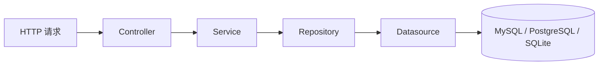
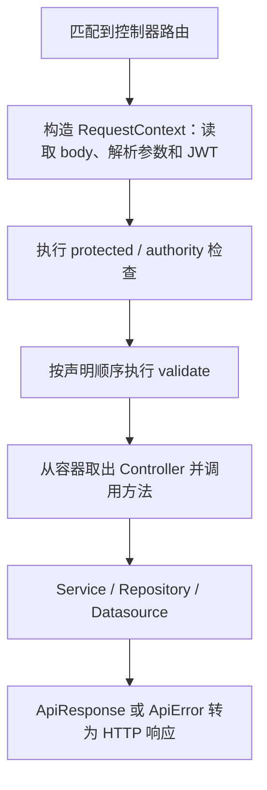

# 架构设计

Stemson 把接口处理拆成 Controller、Service、Repository、Datasource 四层。理解它只需区分两件事：**启动时构造组件，请求时调用组件**。

首次运行和新增接口示例见 [README](../README.md)；本文解释这些行为的实现和边界。

## 1. 四层各自负责什么

| 层 | 责任 | 当前示例 |
|----|------|----------|
| Controller | 接收 HTTP 参数、检查访问权限、组织响应 | `src/controller/user/user_controller.rs` |
| Service | 执行业务规则、组织数据访问 | `src/service/user_service.rs` |
| Repository | 声明 SQL、绑定参数、把结果映射为记录 | `src/repository/user_repository.rs` |
| Datasource | 管理连接池、执行查询和事务 | `src/datasource/mysql.rs`、`postgres.rs`、`sqlite.rs`、`redis.rs` |

一次用户查询沿以下方向调用：



不访问数据库的接口可以只使用 Controller 和 Service，无需为了满足层级而添加 Repository。

## 2. 启动时：先构造依赖，再装配路由

入口 `main.rs` 调用 `stemson::run()`，实际启动逻辑在 `src/app.rs`：

1. 加载 `STEMSON_CONFIG` 指定的 YAML；未指定时读取 `config/config.yaml`。
2. 初始化日志和雪花 ID 生成器。
3. 创建 `AppContext`，初始化 JWT、认证模式和可选的 OPAQUE 服务。
4. 按配置开启文件监听，构造组件容器。
5. 汇总控制器路由，加入 `/health`、Swagger、OpenAPI 和全局中间件。
6. 绑定地址；若 `NACOS_REGISTRY_ENABLED=true`，使用实际端口注册临时实例并启动心跳，然后接收请求。Ctrl-C / SIGTERM 时停止心跳并注销，再进入 HTTP 优雅停机。

`AppContext` 保存配置、组件、认证服务和路由表。`AppState` 把这个上下文交给 Axum handler；`RequestContext` 则保存某一次请求的数据。

### 2.1 “自动注册”发生在哪个阶段

| 阶段 | 发生的事 |
|------|----------|
| 编译 | 过程宏生成构造函数、注册条目和 handler |
| 链接 | `inventory` 收集参与编译的组件条目 |
| 启动 | `AppContext::build_components()` 调用构造函数，建立实例 |
| 请求 | handler 从容器取出已有控制器，调用方法 |

因此新增文件仍需在 `mod.rs` 中声明。未参与编译的模块不会被发现；这里没有运行时目录扫描。

### 2.2 构造顺序与依赖约束

调用方向是 Controller → Service → Repository → Datasource；**构造顺序反过来**：

```text
Datasource → Repository → Service → Controller
```

同层组件按注册名排序。构造一个组件时，它的依赖必须已经存在；容器不会进行依赖图排序，也不会自动解决循环依赖。设计依赖时应指向更早构造的层，避免依赖同层名称排序。

同一层的注册名不能重复，同一个 Rust 类型也不能重复注册，冲突会导致启动失败。

### 2.3 宏与字段注入

```rust
#[stemson::service]
pub struct UserService {
    user_repository: std::sync::Arc<UserRepository>,
}
```

这里 `#[service]` 同时生成构造逻辑并注册组件。Controller 的惯用写法分为两步：在结构体上 `#[derive(Autowired)]` 生成构造逻辑，在 `impl` 上 `#[controller]` 注册组件和路由。

| 字段或宏 | 含义 |
|----------|------|
| `dependency: Arc<T>` | 按 Rust 类型解析已有组件 `T` |
| `config: Arc<Config>` | 注入当前应用配置对象 |
| `#[value("server.name")] name: String` | 构造时读取并反序列化配置；缺失或类型错误会使启动失败 |
| `#[skip] cache: OnceLock<T>` | 用 `Default::default()` 初始化，供运行期使用 |
| `#[derive(Autowired)]` | 只生成构造逻辑，本身不注册组件 |
| `#[service]` / `#[repository]` / `#[datasource("name")]` | 生成构造逻辑、层标记 trait 和注册条目 |
| `#[controller(...)]` | 为 `impl` 生成路由、handler 和组件注册；结构体需实现 `Autowire` |

普通组件默认名为类型名的 snake_case，例如 `UserService` → `user_service`；数据源可显式命名为 `mysql`。字段注入按类型进行，不要求字段名与注册名相同。

`resolve_by_name("mysql")` 用于按名字查找。同名跨层时按 Datasource、Repository、Service、Controller 的顺序返回第一个结果；业务代码优先使用按类型注入。

## 3. 路由：基础路径 + 方法子路径

### 3.1 显式路径

```rust
#[stemson::controller("/v1/api/auth")]
impl AuthController {
    #[get("/me")]
    async fn me(&self, ctx: RequestContext) -> ApiResult<ApiResponse> {
        // 业务处理
        todo!()
    }
}
```

基础路径 `/v1/api/auth` 与子路径 `/me` 拼接，得到 `GET /v1/api/auth/me`。
`#[post]` 没有子路径时直接使用基础路径，**不会把方法名追加到 URL**。

支持 `get`、`post`、`put`、`delete`、`patch`、`head`、`options`。路径参数使用 `/{id}`，由 `ctx.path_param("id")` 读取。

### 3.2 省略基础路径时自动推导

对于位于 `src/controller/` 下的控制器：

```text
模块路径 stemson::controller::user::user_controller
去掉前缀 stemson::controller
剩余模块段转 snake_case，并追加结构体名的 snake_case

AddUser → /user/user_controller/add_user
```

| 声明 | 路由 |
|------|------|
| `AddUser` + `#[controller]` + `#[post]` | `POST /user/user_controller/add_user` |
| `GetAllInfo` + `#[controller("/getall")]` + `#[post]` | `POST /getall` |
| `AuthController` + `#[controller("/v1/api/auth")]` + `#[get("/me")]` | `GET /v1/api/auth/me` |

这些规则保留 Python 版的实际用户接口路径。若希望文件重命名不改变外部 URL，应声明显式路径。

### 3.3 路由表与 OpenAPI

控制器宏同时生成 `routes()` 和 `route_entries()`。装配时将后者存入 `AppContext`，供自检和测试使用。

OpenAPI 描述在 `src/openapi.rs` 中独立维护，控制器宏不会自动把新接口加入 OpenAPI。`tests/router.rs` 检查文档中的路径是否存在于路由表；新增接口时仍需同步维护文档。

## 4. 请求时：解析、鉴权、校验、调用



1. **先解析请求。** body 读入内存一次，再按 Content-Type 解析 JSON、form 或 multipart。错误的 JSON 或过大的 body 可在鉴权之前返回错误。
2. **再执行宏声明的鉴权。** `#[protected]` 要求有效 JWT；`#[authority]` 检查 JWT 中的身份。
3. **再执行声明式校验。** 第一条失败的规则立即返回。
4. **最后调用控制器方法。** 方法内部仍可执行 `require_admin()` 等业务权限检查，这些检查发生在宏校验之后。

有效 JWT 只解析为 Claims，不会使每个受保护接口都查询数据库。组件在请求之间共享，字段注入不会按请求重复执行。

全局中间件提供 CORS、请求追踪、panic 兜底和可选超时。404、405、超时、业务错误统一转为业务响应体；Swagger 页面和 OpenAPI JSON 使用各自格式。

### 参数从哪里读取

| API / 作用域 | 来源 |
|--------------|------|
| `ctx.json_as::<T>()` / `json` | JSON 对象请求体 |
| `form` | URL 编码表单或 multipart 普通字段 |
| `args` | URL query |
| `ctx.path_param("id")` / `path` | 路由路径参数 |
| `ctx.file("file")` / `files` | multipart 文件及其元数据 |
| `ctx.text("key")` / `all` | 合并后的参数视图 |

`all` 中同名参数的覆盖优先级由高到低为：**json > files > args > form > path**。需要确定来源时使用显式作用域，避免 body 覆盖同名路径参数。

multipart 文件也会整体读入内存。请求体大小由 `server.http.request_max_size` 控制。

## 5. 校验与权限分别检查什么

### 5.1 参数校验

```rust
#[validate(
    json,
    not_empty(["username", "password"]),
    length("password", 5, 20, "Length of password must be 5 to 20"),
)]
```

| 规则 | 用途 |
|------|------|
| `not_empty(["key"])` | 要求字段存在且不是 `null`（空字符串仍可通过） |
| `length("key", min, max, "message")` | 长度范围 |
| `range("key", min, max, "message")` | 数值范围 |
| `pattern("key", r"...", match, "message")` | 正则匹配；`match` 从开头匹配，`search` 任意位置搜索 |
| `enum_string("key", ["a", "b"], "message")` | 字符串枚举 |
| `assert("key", fn_name, "message")` | 自定义值断言 |
| `assert_file("key", fn_name, "message")` | 自定义文件断言 |

默认作用域为 `all`，也可显式指定 `json/form/args/path/files`。`not_empty` 对缺失 / `null` 返回 `0010`，其他规则的非法值通常返回 `0015`；非空字符串等业务要求需另加长度或自定义检查。

### 5.2 认证与授权

认证回答“是谁”，授权回答“能做什么”：

| 检查 | 判断依据 |
|------|----------|
| `#[protected]` / `ctx.require_user()` | JWT 签名、有效期等是否有效 |
| `ctx.require_admin(...)` | Claims 的 `role != 0` |
| `#[authority([UserIdentity::Admin])]` | Claims 的 `identity` 是否满足管理员身份 |

`role` 为 0（普通用户）或 1（管理员）。`identity` 为 1（超管）、2（管理员）、3（普通用户），**数字越小权限越高**；超管可以访问要求管理员身份的接口。

两者是独立字段。当前大部分用户管理接口检查 `role`，`/getall` 检查 `identity`，不能把两套规则当作同一检查。

密码登录和 OPAQUE 登录成功后都签发 JWT。两种登录和邀请注册的协议细节见 [API 文档](API.md#3-认证先选登录方式再获取-jwt)。

## 6. 数据访问与事务

MySQL / PostgreSQL / SQLite 连接池和 Redis 连接管理器都在首次使用时初始化。因此启动成功或 `/health` 返回 200，并不表示数据库可用或已建表。

Repository 声明 SQL，Datasource 执行并转换错误。例如按用户 ID 查询时使用占位符与参数绑定：

```rust
// PostgreSQL 示例：注入 Arc<PostgresDataSource>。
self.postgres
    .fetch_optional(sqlx::query_as::<_, (i64, String)>(
        "SELECT uid, username FROM \"user\" WHERE uid = $1",
    ).bind(uid))
    .await
```

用户输入 `uid` 通过 `.bind(uid)` 传入。MySQL / SQLite 使用 `?` 占位；PostgreSQL 使用 `$1`、`$2`。PostgreSQL 的 `user` 是保留字，表名必须加双引号。内置 UserRepository 按 `datasource.driver` 选择原生驱动和对应 SQL，保留时间戳和二进制字段的类型映射。

- `fetch_all` / `fetch_optional` / `fetch_one`：查询并映射为 Rust 记录。
- `execute`：执行写操作。
- `execute_many`：同一语句多组参数，在内部事务中批量执行。
- `begin`：显式创建事务，由调用方组织多条语句并提交。例如创建用户和复制用户组需在同一事务中完成。

MySQL 的 `execute_many` 使用 `&[Vec<SqlParam>]`；PostgreSQL 的版本使用原生 `Vec<PgArguments>`，使 NULL 参数也能携带类型：

```rust
use sqlx::{postgres::PgArguments, Arguments};

let mut row = PgArguments::default();
row.add(42_i64)?;
row.add(None::<String>)?;
self.postgres.execute_many(
    "INSERT INTO example (id, note) VALUES ($1, $2)",
    vec![row],
).await?;
```

PostgreSQL 连接配置为 `datasource.postgres.host/port/user/password/db_name/max_usage/acquire_timeout`。默认端口 5432，池大小 30，等待超时 10 秒；会话时区为 UTC。初始化脚本使用 `TIMESTAMP WITHOUT TIME ZONE`，与现有 `NaiveDateTime` 数据模型匹配。

SQLite 使用 `datasource.driver: sqlite` 和 `datasource.sqlite.path`（默认 `stemson.db`）。`create_if_missing` 默认开启，只创建文件；表结构通过 `sqlite/create_database.sql` 初始化。文件路径相对于工作目录，父目录需已存在。文件数据库启用 WAL，`max_usage` 默认 5，`acquire_timeout` 默认 10 秒，`busy_timeout` 默认 5 秒。SQLite 同一时刻只有一个写事务，写入竞争超过等待时间会返回数据库错误。

SQLite 的查询和事务接口与其他数据源一致，`execute_many` 接收 `Vec<SqliteArguments<'_>>`。`path: ":memory:"` 强制使用一个连接并关闭空闲和生命周期回收，避免连接池丢失内存数据；不同数据源实例的内存数据库互相隔离。初始化脚本用 INTEGER 保存 64 位 ID、BLOB 保存 OPAQUE 注册记录、TEXT 保存 UTC 时间。邀请过期检查通过 `julianday` 比较时间值，避免字符串格式影响判断。

Redis 提供 `get/set/set_ex/del/get_json/ping` 和 `set_if_absent_ex`。后者执行原子 `SET NX EX`，用于 OPAQUE 多副本防重放。

## 7. 配置什么时候生效

`Config::get("a.b.c")` 按点号逐层取值；`string/i64/u16/bool/get_as/require` 提供类型化读取。配置是完整文件加载，不是默认配置与开发配置合并。

应用启动使用 `Config::load_default_with_nacos().await`：先加载 `STEMSON_CONFIG` 指定的本地文件，再在 `NACOS_ENABLED=true` 时拉取远端 YAML。远端对象递归合并，数组、标量和 `null` 整体覆盖，未指定字段保留本地值。连接参数完全来自 `NACOS_*` 环境变量，详见 [Nacos 配置说明](../README.md#使用-nacos-配置中心)。拉取在日志、JWT、组件和路由初始化前完成；404 或空内容回退本地，连接、认证和解析错误使启动失败。同步 `Config::load/load_default` 保持仅加载本地文件的行为。

开启 `server.config_watch` 后，`notify` 监听文件变更，200 ms 去抖，再用 `arc-swap` 原子替换配置快照。**快照更新不等于已构造的对象被重建。**

已启用 Nacos 时，本地热重载会重新应用启动时拉取的远端覆盖，维持 Nacos 的优先级。当前仅在启动时拉取，不监听远端变更；Nacos 内容及连接环境变量变更需要重启。

服务注册由独立的 `NACOS_REGISTRY_ENABLED` 控制，与配置拉取共享 `src/nacos/client.rs` 中的地址、命名空间和认证逻辑。`src/nacos/registry.rs` 使用 v1 HTTP OpenAPI 注册临时实例、发送完整心跳，并在服务端报告实例丢失时重新注册。认证令牌按 TTL 提前刷新，401/403 触发一次重新登录重试。实例使用 `NACOS_SERVICE_NAME`（默认合并后的 `server.name`）、独立服务分组和可达的 IP/端口；监听通配地址时必须指定 `NACOS_INSTANCE_IP`。注册失败使启动失败，心跳错误记录后继续重试，正常退出先注销；非正常退出由服务端按临时实例超时清理。第三方按相同服务名、分组、命名空间发现健康实例，再调用原 HTTP API；具体参数和调用示例见 [Nacos 注册中心](../README.md#使用-nacos-注册中心)。

| 配置用途 | 生效时机 |
|----------|----------|
| `/health` 中的 `server.name`、请求体大小上限 | 后续请求重新读取时生效 |
| `#[value("...")]` 注入到普通字段的值 | 组件构造时固定，需重启 |
| 端口、CORS、请求超时、日志、JWT、认证模式、OPAQUE 参数 | 启动或路由装配时读取，需重启 |
| `datasource.driver`、MySQL / PostgreSQL / SQLite / Redis 连接参数 | 首次使用后保留，修改后应重启 |

JWT 密钥由 `JwtService` 在初始化时读取，支持 `STEMSON_JWT_SECRET` 覆盖。

## 8. OPAQUE 状态与部署边界

OPAQUE 把密码验证拆成客户端与服务端的两轮交换。这里有三类不同的数据：

| 数据 | 保存位置 | 用途 |
|------|----------|------|
| 用户注册记录 | 所选数据库的 `user.opaque_registration` | 后续密码证明 |
| 长期服务端密钥 | `server.auth.opaque.setup_file` | 协议计算与登录状态加密；必须持久保存、备份 |
| 已提交登录 session 的标记 | 进程内存或共享 Redis | 防止相同 session 重复提交 |

`login/start` 把中间状态加密成 `session` 交给客户端；`login/finish` 解密并验证。持有相同 setup 的实例都能处理第二轮，无需粘性会话。

不过，**一次性检查需要保存已用标记**：默认 `single_use: true`，单实例用 `nonce_store: memory`；多实例使用同一 setup、数据库和共享 Redis，并设置 `nonce_store: redis`。内存标记随进程重启丢失，不具备跨重启防重放能力。

第二轮在验证前占用标记，错误提交也会消耗 session。客户端失败重试时应重新发起第一轮。

## 9. 修改框架时从哪里入手

| 目标 | 位置与操作 |
|------|------------|
| 新增数据源 | `#[datasource("name")]` 结构体；宏生成层标记，Repository 按类型注入 |
| 新增校验规则 | `src/core/decorator/validate.rs` + `stemson-macros/src/validate.rs` |
| 新增中间件、修改 404/405/panic 行为 | `src/app.rs::build_router` 及对应 handler |
| 调整错误体或业务码 | `src/exception.rs`、`src/model/response.rs`、`src/model/status_code.rs` |
| 增补接口文档 | `src/openapi.rs` + `docs/API.md` |

日志由 `tracing` 输出到控制台和按天轮转的文件，`backupCount` 控制保留数量。兼容的 Python 风格模板中，`%(funcName)s` 只能输出 `event`；`maxBytes` 保留为兼容配置项，不控制轮转。
